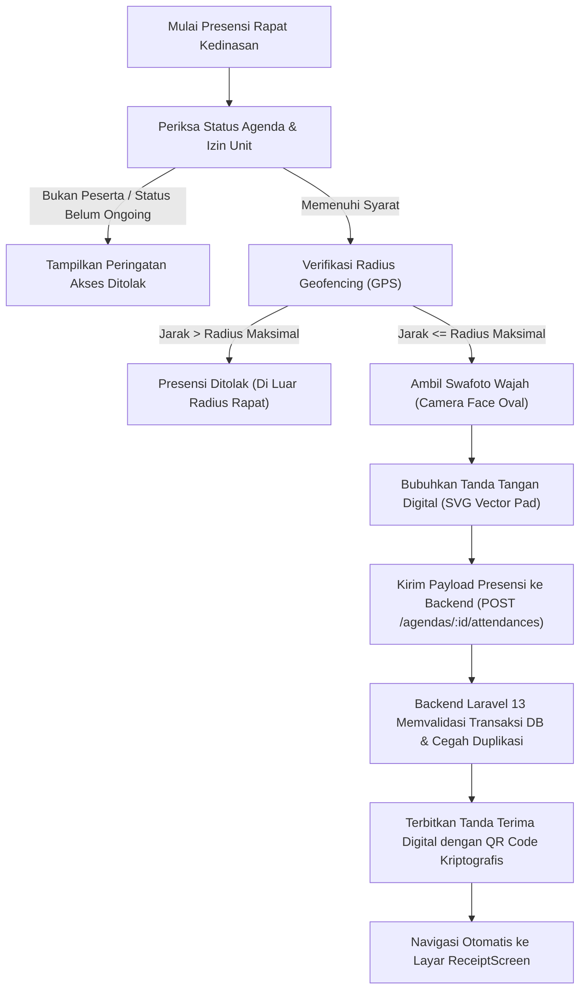
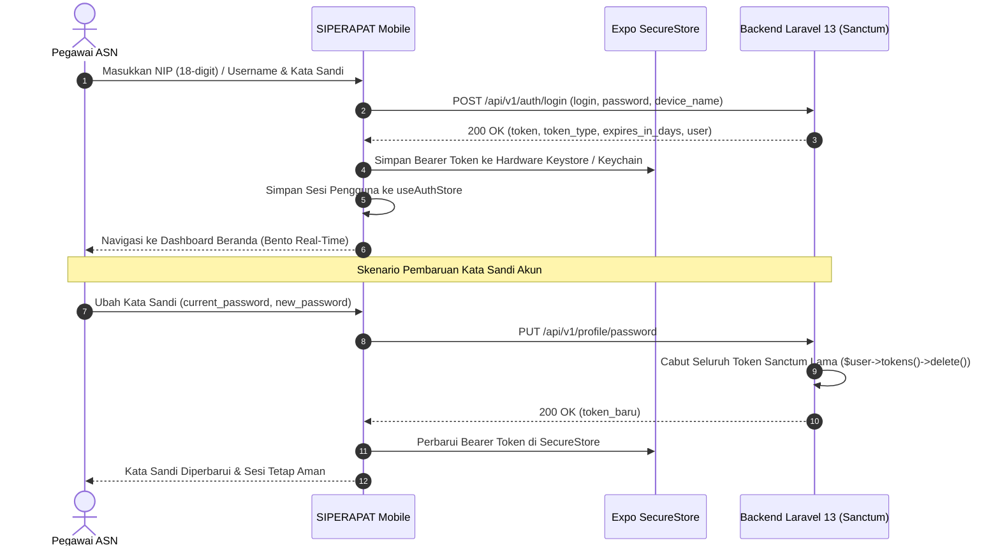

# SIPERAPAT Mobile
### Sistem Informasi Presensi & Rapat Kedinasan — LLDIKTI Wilayah X
**Kementerian Pendidikan Tinggi, Sains, dan Teknologi (Kemendiktisaintek) Republik Indonesia**

[](https://reactnative.dev/)
[](https://expo.dev/)
[](https://www.typescriptlang.org/)
[](https://github.com/pmndrs/zustand)
[](https://laravel.com/)
[](https://laravel.com/docs/sanctum)
[](https://www.w3.org/WAI/WCAG21/quickref/)
[](LICENSE)

---

## 1. Ringkasan Eksekutif (Executive Summary)

**SIPERAPAT Mobile** adalah aplikasi klien mobile resmi berbasis **React Native** dan **Expo SDK 58** yang dirancang untuk mendigitalkan seluruh siklus tata kelola rapat kedinasan di lingkungan **Lembaga Layanan Pendidikan Tinggi (LLDIKTI) Wilayah X** (Sumatera Barat & Jambi). Aplikasi ini terintegrasi langsung secara *stateless* dengan backend enterprise **Laravel 13** melalui protokol **REST API v1**.

Sistem ini mentransformasi presensi rapat kedinasan konvensional berbasis kertas menjadi sistem digital berkeamanan tinggi yang memenuhi standar hukum administrasi pemerintahan:
* **Verifikasi Presensi Multimodal**: Menggabungkan pembatasan radius lokasi (*geofencing GPS*), pengambilan swafoto biometrik wajah langsung (*in-app camera capture* dengan panduan *face oval overlay*), dan pembubuhan tanda tangan basah digital (*digital signature pad* berbasis SVG koordinat vektor).
* **Tanda Terima Digital Kriptografis**: Penerbitan bukti kehadiran otomatis yang dilengkapi **QR Code dinamis** berisikan token verifikasi kedinasan, stempel waktu ISO-8601 WIB (`+07:00`), dan metadata instansi resmi.
* **Manajemen Agenda & Surat Edaran In-App**: Penjadwalan rapat lintas unit kerja (Hybrid, Offline, Online) dengan fitur pratinjau berkas Surat Edaran resmi (*in-app document viewer*) tanpa harus melempar tautan ke peramban eksternal.
* **Notulensi & RTL Real-Time**: Pencatatan risalah, kesimpulan, dan rencana tindak lanjut (RTL) yang dapat langsung diisi dan ditinjau oleh pimpinan maupun notulis yang ditugaskan.
* **Tata Kelola Pegawai & Unit Kerja**: Manajemen akun pegawai ASN, penugasan pimpinan/notulis rapat, dan rekapitulasi kehadiran berbasis *Role-Based Access Control* (RBAC).

---

## 2. Arsitektur Perangkat Lunak (Clean Architecture)

Aplikasi SIPERAPAT Mobile dibangun dengan mematuhi prinsip **Clean Architecture** (Robert C. Martin) yang memisahkan kode ke dalam 4 lapisan independen:

```
┌─────────────────────────────────────────────────────────────┐
│                    PRESENTATION LAYER                       │
│  Screens (React Native) · Components · Navigation · Zustand │
└──────────────────────────────┬──────────────────────────────┘
                               │ relies on
┌──────────────────────────────▼──────────────────────────────┐
│                       DOMAIN LAYER                          │
│     Entities (ASN, Meeting, Attendance) · Repository Interfaces│
└──────────────────────────────▲──────────────────────────────┘
                               │ implemented by
┌──────────────────────────────┴──────────────────────────────┐
│                        DATA LAYER                           │
│  Repository Impl · Datasources (API Client, SecureStore) · Mappers│
└──────────────────────────────┬──────────────────────────────┘
                               │ config & tokens
┌──────────────────────────────▼──────────────────────────────┐
│                        CORE LAYER                           │
│       Design Tokens (WCAG 2.1 AA) · Config · Utilities      │
└─────────────────────────────────────────────────────────────┘
```

### 2.1. Deskripsi Lapis Arsitektur
1. **Domain Layer (`src/domain/`)**:
   - Berisi definisi entitas inti institusional ([`types.ts`](file:///home/daffiq/Documents/Semester-5/lldikti-x-mobile/siperapat/src/domain/entities/types.ts)) seperti `ASN`, `Meeting`, `Attendance`, `Employee`, dan `AuditLog`.
   - Menetapkan kontrak antarmuka repositori murni ([`interfaces.ts`](file:///home/daffiq/Documents/Semester-5/lldikti-x-mobile/siperapat/src/domain/repositories/interfaces.ts)) seperti `IAuthRepository`, `IMeetingRepository`, `IAttendanceRepository`, dan `IEmployeeRepository`.
   - **Bebas dari segala dependensi eksternal, framework UI, maupun library pihak ketiga**.

2. **Data Layer (`src/data/`)**:
   - Mengimplementasikan seluruh interface domain ([`src/data/repositories/`](file:///home/daffiq/Documents/Semester-5/lldikti-x-mobile/siperapat/src/data/repositories/)).
   - **API Client** ([`apiClient.ts`](file:///home/daffiq/Documents/Semester-5/lldikti-x-mobile/siperapat/src/data/datasources/apiClient.ts)): Klien HTTP berbasis `fetch` native dengan dukungan JSON, Multipart form-data, stream binary/Blob, timeout 20 detik, dan penyamaran log error jaringan untuk mencegah kebocoran kredensial.
   - **Auth Token Store** ([`authTokenStore.ts`](file:///home/daffiq/Documents/Semester-5/lldikti-x-mobile/siperapat/src/data/datasources/authTokenStore.ts)): Penyimpanan kredensial Bearer Token berbasis enkripsi perangkat keras (**Expo SecureStore** di Android Keystore / iOS Keychain).
   - **Data Mappers** ([`apiMappers.ts`](file:///home/daffiq/Documents/Semester-5/lldikti-x-mobile/siperapat/src/data/mappers/apiMappers.ts)): Melakukan transformasi data transfer objects (DTO) backend Laravel menjadi model entitas domain yang bersih.

3. **Presentation Layer (`src/presentation/`)**:
   - **State Management**: Menggunakan **Zustand 5** yang terisolasi per konteks bisnis (`useAuthStore`, `useMeetingStore`, `useAttendanceStore`, `useEmployeeStore`, `useFeedbackStore`, `useTransitionStore`).
   - **Navigasi Murni**: Menggunakan **React Navigation v7** dengan kombinasi `NativeStackNavigator` dan `BottomTabNavigator`. Gestur swap/swipe horizontal antar layar telah dieliminasi 100% demi mencegah konflik sentuhan dan menjaga kekokohan aplikasi enterprise.
   - **Real-Time Data Lifecycle**: Setiap layar utama tab mengimplementasikan `useFocusEffect` dengan pemuatan data *stale-while-revalidate*, menjamin data yang ditampilkan selalu termutakhirkan saat tab dibuka.
   - **Komponen Modular**: Pemisahan komponen kartu Bento, modal filter, signature canvas, overlay kamera oval, dan tanda terima digital.

4. **Core Layer (`src/core/`)**:
   - **Design Tokens**: Palet warna institusional Gov-Tech ([`colors.ts`](file:///home/daffiq/Documents/Semester-5/lldikti-x-mobile/siperapat/src/core/theme/colors.ts)), tipografi berjenjang ([`typography.ts`](file:///home/daffiq/Documents/Semester-5/lldikti-x-mobile/siperapat/src/core/theme/typography.ts)), dan skala elevasi/radius ([`tokens.ts`](file:///home/daffiq/Documents/Semester-5/lldikti-x-mobile/siperapat/src/core/theme/tokens.ts)).
   - **Konfigurasi Lingkungan**: Pengelolaan endpoint API melalui environment variable ([`apiConfig.ts`](file:///home/daffiq/Documents/Semester-5/lldikti-x-mobile/siperapat/src/core/config/apiConfig.ts)).
   - **Utilitas Resolusi Media**: Penanganan kanonikal URL surat edaran dan berkas media dinas ([`mediaUrl.ts`](file:///home/daffiq/Documents/Semester-5/lldikti-x-mobile/siperapat/src/core/utils/mediaUrl.ts)).

---

## 3. Diagram Alur Sistem (System Flowcharts)

### 3.1. Alur Verifikasi Presensi Rapat Multimodal


### 3.2. Siklus Autentikasi & Rotasi Token Sesi


---

## 4. Integrasi Backend Laravel 13 & Kontrak REST API

Aplikasi mobile berkomunikasi dengan backend **Laravel 13 (PHP 8.3+)** menggunakan format JSON standar:

### 4.1. Konvensi Dasar
* **Base URL**: `https://siperapat.web.id/api/v1` (atau konfigurasi lokal `http://<IP_HOST>:8000/api/v1`).
* **Header Wajib**:
  ```http
  Accept: application/json
  Content-Type: application/json
  Authorization: Bearer <PERSONAL_ACCESS_TOKEN>
  ```
* **Format Timestamp**: Seluruh waktu dikirim dan diterima dalam standar **ISO-8601** dengan offset Waktu Indonesia Barat (`+07:00`), contoh: `2026-11-02T09:00:00+07:00`.
* **Format Enum Status**: Setiap enum disajikan dalam format terjemahan `{ "value": string, "label": string }` sehingga UI klien tidak melakukan *hardcoding* teks status.

### 4.2. Struktur Amplop JSON Standar (Standard JSON Envelope)
#### Respons Sukses (HTTP 200 / 201):
```json
{
  "code": 200,
  "status": "success",
  "message": "Data berhasil dimuat.",
  "data": { ... },
  "meta": {
    "current_page": 1,
    "last_page": 5,
    "total": 50,
    "per_page": 10
  }
}
```

#### Respons Kesalahan Validasi (HTTP 422 Unprocessable Content):
```json
{
  "code": 422,
  "status": "error",
  "message": "Format nomor telepon tidak valid.",
  "errors": {
    "phone": ["Nomor telepon harus terdiri dari 9 hingga 16 digit."]
  }
}
```

### 4.3. Matriks Endpoint Utama

| Modul | Method | Endpoint | Deskripsi & Autorisasi |
|---|---|---|---|
| **Autentikasi** | `POST` | `/auth/login` | Login ASN multi-identifier (NIP/Username/Email) & penerbitan token Sanctum |
| | `GET` | `/auth/me` | Bootstrap sesi pengguna aktif dan hak akses peran |
| | `POST` | `/auth/logout` | Pencabutan personal access token Sanctum aktif |
| **Profil & Akun**| `GET` | `/profile` | Membaca rincian profil ASN, unit kerja, dan log keamanan |
| | `PUT` | `/profile` | Memperbarui kontak kedinasan (nomor WhatsApp resmi) |
| | `PUT` | `/profile/password` | Mengubah kata sandi akun disertai rotasi token otomatis |
| **Dashboard** | `GET` | `/dashboard` | Agregasi metrik agenda (*total, ongoing, upcoming, completed*) & agenda aktif |
| **Agenda Rapat** | `GET` | `/agendas` | Daftar agenda dengan filter status, tipe (Hybrid/Offline/Online), dan paginasi |
| | `GET` | `/agendas/{id}` | Rincian lengkap agenda, pimpinan, notulis, dan berkas surat edaran |
| | `POST` | `/agendas` | Pembuatan agenda rapat baru (*Admin Unit / Administrator*) |
| | `PUT` | `/agendas/{id}` | Pembaruan data rapat kedinasan |
| | `DELETE`| `/agendas/{id}` | Penghapusan agenda (ditolak jika sudah ada presensi) |
| | `POST` | `/agendas/{id}/surat-edaran` | Unggah berkas Surat Edaran resmi (PDF / Gambar) |
| | `PUT` | `/agendas/{id}/notulen` | Simpan notulensi, risalah kesimpulan, dan dokumentasi rapat |
| **Presensi** | `GET` | `/agendas/{id}/attendance-portal` | Periksa kelayakan presensi (*ongoing, unit eligible, belum presensi*) |
| | `POST` | `/agendas/{id}/attendances` | Kirim bukti kehadiran (Swafoto + Tanda Tangan + Lokasi) |
| | `GET` | `/attendances/my-history` | Riwayat presensi pribadi pegawai ASN |
| | `GET` | `/attendances/{id}/receipt` | Ambil tanda terima presensi digital dan token verifikasi QR |
| | `GET` | `/agendas/{id}/attendances` | Monitoring peserta terverifikasi sah dan peserta belum hadir |
| **Tata Kelola** | `GET` | `/users` | Direktori pegawai ASN dengan filter unit dan pencarian |
| | `GET` | `/units` | Master data unit kerja / Pokja LLDIKTI X |
| | `GET` | `/activity-logs` | Jejak audit keamanan global (*Administrator only*) |
| | `GET` | `/profile/logs` | Jejak audit keamanan akun pribadi |
| **Pelaporan** | `GET` | `/reports/agendas/{id}/export/{format}` | Ekspor Berita Acara & Daftar Hadir (`pdf`, `word`, `csv`) |

---

## 5. Sistem Desain & Aksesibilitas (Gov-Tech Institutional)

Antarmuka SIPERAPAT Mobile mengikuti bahasa desain **Modern Gov-Tech Institutional** yang formal, berwibawa, namun tetap ringan, bersih, dan cepat.

### 5.1. Palet Warna (WCAG 2.1 AA Compliant)
* **Institutional Navy (`#00236F`)**: Warna primer negara yang melambangkan legitimasi, otoritas kedinasan, dan integritas.
* **Primary Interactive (`#0051D5`)**: Warna sekunder untuk pemicu aksi interaktif, status fokus input, dan tombol simpan.
* **Canvas Background (`#F8F9FF`)**: Latar belakang bernuansa *soft-cool* yang tidak menyilaukan mata pada penggunaan jangka panjang.
* **Surface Containers (`#FFFFFF`, `#EFF4FF`, `#E5EEFF`)**: Lapisan kartu berjenjang untuk pemisahan data bento yang terstruktur.
* **Status Semantik Resmi**:
  - `Success` (`#059669` / `#ECFDF5`): Status Hadir Sah, Terverifikasi, dan Berada di Dalam Radius.
  - `Warning` (`#D97706` / `#FFFBEB`): Status Berlangsung, Presensi Dibuka, dan Verifikasi Tertunda.
  - `Danger` (`#BA1A1A` / `#FFDAD6`): Status Batal, Ditolak, Di Luar Radius Geofencing.

### 5.2. Tipografi & Skalabilitas
* **Judul & Header**: *Plus Jakarta Sans* (SemiBold & Bold) memberikan ketegasan struktural pada nama agenda dan angka statistik.
* **Isi & Data Kedinasan**: *Inter* (Regular & Medium) memastikan keterbacaan optimal pada 18-digit NIP, stempel waktu, dan keterangan berita acara.
* **Aksesibilitas (a11y)**: Seluruh komponen interaktif dilengkapi dengan atribut `accessibilityRole`, `accessibilityLabel`, dan ukuran sentuhan minimal *hitSlop* 44x44 dp sesuai rekomendasi platform Android dan iOS.

---

## 6. Struktur Direktori Proyek (Project Structure)

```
siperapat/
├── App.tsx                          # Root Application Container (SafeArea, NavigationContainer, Global Host)
├── app.json                         # Expo Application Configuration & Permissions
├── index.ts                         # Entry Point Registrasi Aplikasi
├── package.json                     # Daftar Dependensi & Skrip Proyek
├── tsconfig.json                    # Konfigurasi Strict TypeScript 6.0
├── .env.example                     # Contoh Konfigurasi Environment Variable
├── assets/                          # Aset Gambar, Ikon, Splash, dan Brand Tut Wuri Handayani
├── docs/                            # Dokumentasi Spesifikasi API & Audit Teknis
│   ├── api-contract-alignment.md
│   ├── api-proposal.md
│   └── backend-deep-audit.md
└── src/
    ├── core/                        # Utilitas & Konfigurasi Fundamental
    │   ├── config/
    │   │   └── apiConfig.ts         # Resolusi Base URL & Timeout Jaringan
    │   ├── theme/
    │   │   ├── colors.ts            # Design Tokens Warna Gov-Tech
    │   │   ├── tokens.ts            # Spacing, Rounded, Elevations
    │   │   └── typography.ts        # Hierarchy Font & Line Heights
    │   └── utils/
    │       ├── formatters.ts        # Formatter Tanggal WIB & NIP
    │       └── mediaUrl.ts          # Normalisasi URL Kanonikal Surat Edaran
    ├── domain/                      # Aturan Bisnis & Entitas Murni (Zero Dependency)
    │   ├── entities/
    │   │   └── types.ts             # Entitas ASN, Meeting, Attendance, Employee
    │   └── repositories/
    │       └── interfaces.ts        # Kontrak Abstraksi Repositori Bisnis
    ├── data/                        # Akses Data, Jaringan, dan Penyimpanan
    │   ├── datasources/
    │   │   ├── agendaApi.ts         # Endpoint Agenda & Dokumen
    │   │   ├── apiClient.ts         # HTTP Client Engine & Log Sanitizer
    │   │   ├── apiTypes.ts          # Backend API DTO & Response Envelopes
    │   │   ├── attendanceApi.ts     # Endpoint Presensi & Bukti Kehadiran
    │   │   ├── authApi.ts           # Endpoint Login, Me, & Profil
    │   │   ├── authTokenStore.ts    # Expo SecureStore Token Manager
    │   │   ├── reportApi.ts         # Endpoint Unduh Berita Acara
    │   │   └── userApi.ts           # Endpoint Pegawai & Unit Kerja
    │   ├── mappers/
    │   │   └── apiMappers.ts        # Transformasi DTO Laravel -> Domain Entities
    │   └── repositories/
    │       ├── AgendaExportRepository.ts
    │       ├── AttendanceRepositoryImpl.ts
    │       ├── AuthRepositoryImpl.ts
    │       ├── DashboardRepositoryImpl.ts
    │       ├── EmployeeRepositoryImpl.ts
    │       └── MeetingRepositoryImpl.ts
    └── presentation/                # Antarmuka Pengguna & Manajemen State
        ├── components/
        │   ├── attendance/          # DigitalSignaturePad, FaceOvalOverlay
        │   ├── cards/               # BentoStatCard, MeetingCard
        │   ├── common/              # Header, EmptyState, ErrorState, PaginationBar
        │   ├── modals/              # DateFilterModal, MeetingFilterModal, SuratEdaranViewerModal
        │   ├── receipt/             # DigitalAttendanceReceiptCard, DynamicQRCode
        │   └── transitions/         # PageTransitionOverlay (Tut Wuri Shimmer)
        ├── navigation/
        │   ├── AppNavigator.tsx     # Native Stack + Bottom Tabs (Swipe Disabled)
        │   └── types.ts             # Navigation Route Parameter Lists
        ├── screens/                 # 18 Layar Bisnis Kedinasan
        │   ├── DashboardScreen.tsx  # Beranda dengan Statistik Bento Real-Time
        │   ├── AgendaScreen.tsx     # Daftar Agenda Rapat & Filter Tipe
        │   ├── RiwayatScreen.tsx    # Riwayat Kehadiran Pegawai
        │   ├── ProfileScreen.tsx    # Informasi Akun & Edit Nomor WhatsApp
        │   ├── PresensiScreen.tsx   # Geofence + Kamera Wajah + Tanda Tangan
        │   ├── ReceiptScreen.tsx    # Tanda Terima Digital & Bukti Sah
        │   ├── MonitoringScreen.tsx # Rapat Detail, Peserta Sah/Belum, Notulensi
        │   ├── CreateMeetingScreen.tsx # Formulir Agenda Rapat Baru
        │   ├── EditMeetingScreen.tsx   # Edit Rapat Kedinasan
        │   ├── EmployeeDirectoryScreen.tsx # Direktori Pegawai ASN
        │   ├── AddEmployeeScreen.tsx   # Tambah Pegawai Baru
        │   ├── EditEmployeeScreen.tsx  # Ubah Data Pegawai
        │   ├── AddUnitScreen.tsx       # Tambah Unit Kerja
        │   ├── EditUnitScreen.tsx      # Ubah Unit Kerja
        │   ├── AuditLogScreen.tsx      # Jejak Audit Aktivitas Sistem
        │   ├── ChangePasswordScreen.tsx# Ganti Kata Sandi & Rotasi Token
        │   ├── SplashScreen.tsx        # Pembuka Resmi Institusi
        │   ├── LoginScreen.tsx         # Masuk Akun ASN Multi-Identifier
        │   └── ForgotPasswordScreen.tsx# Pemulihan Akun Kedinasan
        └── store/                   # Zustand Atomic Reactive Stores
            ├── useAttendanceStore.ts
            ├── useAuthStore.ts
            ├── useDashboardStore.ts
            ├── useEmployeeStore.ts
            ├── useFeedbackStore.ts
            ├── useMeetingStore.ts
            └── useTransitionStore.ts
```

---

## 7. Prasyarat & Panduan Instalasi (Getting Started)

### 7.1. Prasyarat Lingkungan (Environment Prerequisites)
* **Node.js**: Versi `18.x` atau `20.x` LTS (disarankan v20+).
* **Package Manager**: `npm` versi 9+ atau `pnpm`.
* **Platform SDK**:
  - Untuk Android: Android Studio dengan Android SDK Platform 34 (API 34) & Build Tools terkonfigurasi.
  - Untuk iOS: macOS dengan Xcode 15+ dan CocoaPods terpasang.
* **Perangkat Fisik / Simulator**: Disarankan menggunakan perangkat fisik untuk pengujian penuh modul Kamera dan Lokasi Geofencing.

### 7.2. Langkah Instalasi

1. **Clone Repositori**:
   ```bash
   git clone https://github.com/41116120010/siperapat-mobile.git
   cd siperapat-mobile/siperapat
   ```

2. **Instal Dependensi Proyek**:
   ```bash
   npm install
   ```

3. **Konfigurasi Environment Variable**:
   Salin berkas `.env.example` menjadi `.env`:
   ```bash
   cp .env.example .env
   ```
   Buka file `.env` dan arahkan URL ke server API backend Laravel 13 Anda:
   ```env
   # Contoh koneksi server staging / produksi
   EXPO_PUBLIC_API_BASE_URL=https://siperapat.web.id/api/v1

   # Atau contoh koneksi server lokal (gunakan IP LAN mesin backend Anda)
   # EXPO_PUBLIC_API_BASE_URL=http://192.168.1.100:8000/api/v1
   ```

4. **Jalankan Development Server**:
   ```bash
   # Menjalankan bundler Expo Metro
   npx expo start

   # Menjalankan langsung di emulator/perangkat Android
   npx expo start --android

   # Menjalankan langsung di simulator/perangkat iOS
   npx expo start --ios
   ```

---

## 8. Standar Mutu & Verifikasi Kode (Quality Gates)

Setiap perubahan kode pada repositori ini wajib melewati gerbang kualitas enterprise berikut:

### 8.1. Pemeriksaan Tipe Statis (Static Typecheck)
Memastikan 100% konsistensi tipe TypeScript tanpa error:
```bash
npx tsc --noEmit
```
*Target: 0 error.*

### 8.2. Validasi Bundler Metro (Expo Export Test)
Memastikan seluruh modul dan aset grafis terbundle sempurna untuk platform Android dan iOS tanpa kegagalan:
```bash
EXPO_NO_TELEMETRY=1 npx expo export --no-bytecode
```
*Target: Bundling Android & iOS berhasil (Exported: dist), lalu bersihkan direktori sementara dengan `rm -rf dist`.*

### 8.3. Prinsip Nol Pemborosan Dependensi (`/ponytail`)
Proyek ini mengadopsi prinsip efisiensi ketat:
* Dilarang menambahkan dependensi npm eksternal baru jika kapabilitas tersebut dapat dicapai menggunakan API bawaan React Native, komponen Expo yang sudah terpasang, atau logika matematika/algoritma native TypeScript.
* Seluruh fitur navigasi, ikon vektor, penyimpanan aman, manipulasi gambar, dan rendering SVG memanfaatkan library resmi yang telah teruji stabilitasnya di produksi.

---

## 9. Keamanan & Kepatuhan Regulasi (Security & Compliance)

Sebagai aplikasi pengolah data presensi Aparatur Sipil Negara, SIPERAPAT Mobile menerapkan prinsip pertahanan berlapis (*defense-in-depth*):

1. **Perlindungan Token & Sesi (Hardware-Backed Storage)**:
   - Token akses sesi pengguna tidak pernah disimpan di `AsyncStorage` biasa (yang rentan terhadap inspeksi file root).
   - Kredensial disimpan secara eksklusif menggunakan **Expo SecureStore**, memanfaatkan **Android Keystore System** dan **iOS Keychain Services** dengan algoritma enkripsi AES-256 berbasis hardware.
2. **Kepatuhan Privasi Data ASN (UU No. 27 Tahun 2022 tentang PDP)**:
   - Akses kamera perangkat hanya diaktifkan saat layar presensi aktif untuk menangkap swafoto kehadiran dan langsung dimatikan kembali saat keluar layar (*camera lifecycle awareness*).
   - Koordinat GPS hanya dibaca sesaat (*single high-accuracy fix*) untuk menghitung jarak radius ke titik koordinat rapat LLDIKTI X, tanpa pelacakan posisi latar belakang (*no background location tracking*).
3. **Penyamaran Jejak Log Jaringan (Network Log Sanitization)**:
   - Klien HTTP secara ketat menyamarkan log output pada mode *development* maupun *production*.
   - Kata sandi, header `Authorization: Bearer`, nomor identitas token, dan isi body sensitif diproteksi agar tidak bocor ke log terminal maupun crash reporter pihak ketiga.
4. **Integritas Arsip Kedinasan**:
   - Penghapusan agenda rapat dilindungi aturan ketat: jika rapat telah memiliki catatan presensi peserta, agenda tidak dapat dihapus demi menjaga keabsahan Berita Acara dan audit kinerja kedinasan.

---

## 10. Panduan Build & Rilis Produksi (Production Build)

Aplikasi siap dikompilasi ke paket biner produksi (**APK / AAB** untuk Android dan **IPA** untuk iOS) menggunakan **EAS Build** (Expo Application Services):

### 10.1. Build Android (AAB untuk Google Play Console / APK untuk Distribusi Internal)
```bash
# Instal EAS CLI secara global (jika belum ada)
npm install -g eas-cli

# Login ke akun Expo institusi
eas login

# Konfigurasi EAS project (jika pertama kali)
eas build:configure

# Build APK Standalone untuk instalasi langsung pada perangkat dinas
eas build --platform android --profile preview

# Build Android App Bundle (AAB) untuk rilis Google Play Store
eas build --platform android --profile production
```

### 10.2. Pengaturan Versi & Identitas Aplikasi
Identitas bundel aplikasi dikonfigurasi pada [`app.json`](file:///home/daffiq/Documents/Semester-5/lldikti-x-mobile/siperapat/app.json):
* **Android Package Name**: `id.go.lldikti10.siperapat`
* **iOS Bundle Identifier**: `id.go.lldikti10.siperapat`
* **Version**: `1.0.0`
* **Build Number / Version Code**: Ditingkatkan bertahap pada setiap siklus rilis produksi.

---

## 11. Hak Cipta & Lisensi

Proyek ini dikembangkan untuk kebutuhan operasional kedinasan di lingkungan:
**Lembaga Layanan Pendidikan Tinggi (LLDIKTI) Wilayah X**  
*Kementerian Pendidikan Tinggi, Sains, dan Teknologi Republik Indonesia*  
Jl. Khatib Sulaiman, Padang, Sumatera Barat.  
Laman Resmi: [https://lldikti10.kemdikbud.go.id](https://lldikti10.kemdikbud.go.id)

Didistribusikan di bawah lisensi resmi institusi ([LICENSE](LICENSE)).
