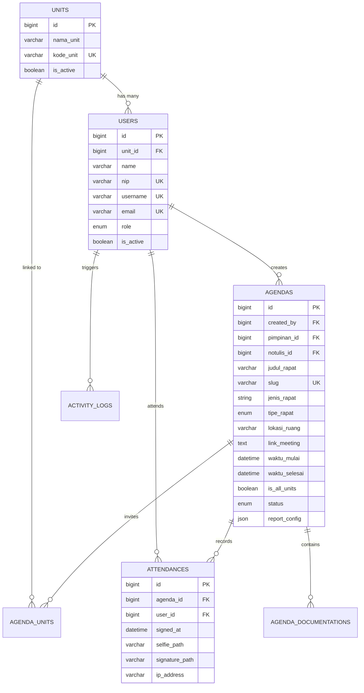

# AUDIT MENDALAM BACKEND LARAVEL SIPERAPAT (LLDIKTI WILAYAH X)
**Repository:** `https://github.com/41116120010/lldikti-x.git`  
**Direktori Path:** `C:\projects\meet-manager`  
**Framework:** Laravel 11/12+ (`laravel/framework: ^13.8` skeleton, PHP `^8.3`)  
**Database Engine:** MySQL / MariaDB  
**Status Audit:** Audit Read-Only Selesai (Tanpa Modifikasi File/Database/Git)

---

## 1. INVENTARISASI & STRUKTUR EXISTING BACKEND

Berdasarkan penelusuran menyeluruh terhadap direktori `C:\projects\meet-manager`:

### 1.1 Models (`app/Models`)
1. **`User.php`**: Pengguna sistem kedinasan. Memiliki kolom `unit_id`, `name`, `nip` (unique, 30 chars), `username` (unique, 50 chars), `email` (unique), `password`, `role` (`administrator`, `admin`, `staff`), `phone`, `avatar_path`, `is_active`. Relasi: `belongsTo(Unit)`, `hasMany(Agenda, 'created_by')`, `hasMany(Attendance)`, `hasMany(ActivityLog)`.
2. **`Unit.php`**: Unit kerja / Pokja LLDIKTI X. Kolom: `nama_unit`, `kode_unit` (unique), `deskripsi`, `is_active`. Relasi: `hasMany(User)`, `belongsToMany(Agenda, 'agenda_units')`.
3. **`Agenda.php`**: Agenda rapat kedinasan. Kolom: `created_by`, `pimpinan_id`, `notulis_id`, `judul_rapat`, `slug` (unique), `jenis_rapat` (string, misal `koordinasi`, `pleno`, `konsinyasi`, `terbatas`), `tipe_rapat` (`offline`, `online`, `hybrid`), `lokasi_ruang`, `link_meeting`, `waktu_mulai`, `waktu_selesai` (nullable), `is_all_units`, `surat_edaran_path`, `notulensi` (longText), `kesimpulan` (longText), `report_config` (json array), `status` (`draft`, `scheduled`, `ongoing`, `completed`, `cancelled`).
4. **`AgendaUnit.php`**: Tabel pivot perantara relasi many-to-many `agendas` dan `units` (`agenda_id`, `unit_id`).
5. **`Attendance.php`**: Catatan presensi kehadiran rapat. Kolom: `agenda_id`, `user_id`, `signed_at`, `selfie_path`, `signature_path`, `ip_address`, `user_agent`. Constraint: `unique(['agenda_id', 'user_id'])`.
6. **`AgendaDocumentation.php`**: Foto dokumentasi jalannya rapat. Kolom: `agenda_id`, `file_path`, `caption`, `sort_order`.
7. **`ActivityLog.php`**: Rekam jejak audit keamanan kedinasan. Kolom: `user_id`, `activity_type`, `description`, `target_model`, `target_id`, `properties` (json), `ip_address`, `user_agent`, `created_at`.

### 1.2 Controllers (`app/Http/Controllers`)
1. **`Auth/AuthenticatedSessionController.php`**: Autentikasi sesi berbasis web (Login, Logout, regenerasi sesi).
2. **`DashboardController.php`**: Agregasi statistik kuota rapat dan daftar agenda aktif relevan.
3. **`ProfileController.php`**: Pembaruan profil, kata sandi akun, dan riwayat log aktivitas pribadi (`profile.logs`).
4. **`AgendaController.php`**: Manajemen siklus agenda rapat (Index, Create, Store, Show, Edit, Update, Destroy, UpdateStatus, UpdateRoles, Notulen, UpdateNotulen, DeleteDocumentation).
5. **`AttendanceController.php`**: Portal presensi (`portal`), halaman interaktif periksa presensi (`create`), simpan presensi (`store`), bukti tanda terima presensi (`success`), riwayat presensi pribadi (`history`).
6. **`UserController.php`**: Manajemen pegawai ASN per unit (Index, Create, Store, Edit, Update, Destroy, ToggleStatus).
7. **`UnitController.php`**: Master data unit kerja (Index, Create, Store, Edit, Update, Destroy, ToggleStatus).
8. **`ReportController.php`**: Rekapitulasi eksekutif, konfigurasi berita acara, ekspor PDF (`exportPdf`), Word (`exportWord`), dan CSV (`exportSummaryCsv`).
9. **`ActivityLogController.php`**: Audit log global sistem untuk Administrator.

### 1.3 Policies (`app/Policies`)
- **`AgendaPolicy.php`**: Mengatur hak akses kelola agenda, izin lihat staff (`viewStaff`), izin hapus (hanya jika belum ada presensi), ubah status, dan kelola notulensi.
- **`AttendancePolicy.php`**: Validasi hak presensi (`checkIn`: wajib status `ongoing`, eligible unit, belum presensi), dan hak lihat presensi (`view`).
- **`UserPolicy.php`**: Scoping pegawai (Admin Unit hanya dapat mengelola staf di unitnya sendiri, tidak bisa mengedit akun Administrator).
- **`UnitPolicy.php`**: Hanya Administrator yang dapat mengelola unit kerja.
- **`ActivityLogPolicy.php`**: Hanya Administrator yang dapat melihat log audit sistem.

### 1.4 Services (`app/Services`)
- **`AgendaConflictService.php`**: Engine validasi 5 level bentrok jadwal rapat kedinasan (Waktu lampau, Rapat unit masih ongoing, Bentrok ruangan fisik, Bentrok jadwal pleno vs unit, Bentrok personel Pimpinan & Notulis).
- **`ActivityLogger.php`**: Helper audit trail terpusat pencatat aktivitas user, IP, dan user-agent.
- **`PdfExportService.php`**: Engine render Berita Acara Rapat & Daftar Hadir resmi ke format PDF A4.
- **`WordExportService.php`**: Engine render dokumen Berita Acara ke format Microsoft Word (.doc).

### 1.5 Database Migrations
Terdapat 15 file migration:
- Pembuatan tabel `users` (dengan enum role: `administrator`, `admin`, `staff`), `units`, `sessions`, `password_reset_tokens`.
- Pembuatan tabel `agendas`, `agenda_units`, `attendances`, `agenda_documentations`, `activity_logs`.
- Penambahan index performa pada `agendas`, `activity_logs`, `attendances`.
- Modifikasi `jenis_rapat` menjadi string varchar (memungkinkan jenis rapat kustom).
- Modifikasi `waktu_selesai` menjadi nullable (mendukung rapat "s.d. Selesai").
- Penambahan relasi `pimpinan_id` dan `notulis_id` ke tabel `agendas`.
- Penambahan kolom JSON `report_config` ke tabel `agendas`.

### 1.6 Routes
- `routes/web.php`: 102 baris mendefinisikan seluruh rute web berbasis session cookie.
- `routes/api.php`: **BELUM ADA**. Endpoint API untuk konsumsi mobile belum dibuat.

---

## 2. PEMETAAN BUSINESS LOGIC EXISTING

| Fitur / Alur | Aktor (Role) | Pra-kondisi | Data yang Diperlukan | Perubahan DB | Validasi & Rules | Transaksi & Audit Log |
|---|---|---|---|---|---|---|
| **Login** | Guest (Semua ASN) | Akun terdaftar & `is_active = true` | `login` (NIP/Username), `password` | Regenerasi Session | Rate limit 5x; Sanitasi spasi NIP; Validasi status aktif akun | `ActivityLogger::log('AUTH_LOGIN')` |
| **Logout** | Authenticated User | Sesi aktif | Session token | Invalidate session | Validasi sesi aktif | `ActivityLogger::log('AUTH_LOGOUT')` |
| **Profile Update** | Authenticated User | Login aktif | `name`, `email`, `phone`, `password` (opsional) | `users.update` | Email valid & unik; Kata sandi min 8 chars jika diisi | `DB::transaction`, Log `UPDATE_PROFILE` |
| **Lihat Dashboard** | Semua Role | Login aktif | - | Read only | Scoped berdasarkan role & unit user | - |
| **Buat Agenda** | Administrator, Admin Unit | Unit aktif | `judul_rapat`, `jenis_rapat`, `tipe_rapat`, `lokasi_ruang` / `link_meeting`, `waktu_mulai`, `waktu_selesai`, `is_all_units`, `unit_ids`, `pimpinan_id`, `notulis_id`, berkas `surat_edaran` | Insert `agendas`, insert `agenda_units` | 5 Pengecekan Bentrok via `AgendaConflictService`: waktu lampau (toleransi 15 mnt), unit ongoing conflict, room overlap, unit schedule conflict, personnel overlap | `DB::transaction`, Log `CREATE_AGENDA` |
| **Ubah Agenda** | Administrator, Admin Unit pemilik / rekan se-unit | Agenda belum selesai / dibatalkan | Data perubahan field rapat, penggantian berkas edaran | Update `agendas`, sync `agenda_units` | Validasi conflict service dengan ignore current ID | `DB::transaction`, Log `UPDATE_AGENDA` |
| **Hapus Agenda** | Administrator, Admin Unit pemilik / sasaran | **Tidak boleh ada catatan presensi sama sekali** | ID Agenda | Delete `agendas` (cascade units, docs, attendances), unlink berkas storage | Jika `attendances()->exists()`, **DITOLAK KERAS** (Integritas arsip dinas) | `DB::transaction`, Bersihkan berkas storage, Log `DELETE_AGENDA` |
| **Ubah Status Agenda** | Administrator, Admin Unit pemilik / pimpinan ongoing | Agenda ada | `status` (`draft`, `scheduled`, `ongoing`, `completed`, `cancelled`) | `agendas.status` | State machine validation | `DB::transaction`, Log `UPDATE_AGENDA_STATUS` |
| **Delegasi Pimpinan/Notulis** | Administrator, Admin Unit pemilik | Agenda ada | `pimpinan_id`, `notulis_id` | `agendas.pimpinan_id`, `notulis_id`, auto update `report_config` | User ID harus valid & aktif | `DB::transaction`, Log `UPDATE_AGENDA_ROLES` |
| **Input Notulensi & Docs** | Administrator, Admin Unit pemilik, atau Pimpinan/Notulis ditunjuk saat status `ongoing` | Status agenda **BUKAN** `cancelled` | `notulensi` (HTML), `kesimpulan` (HTML), berkas `photos[]`, `captions[]` | Update `agendas`, insert `agenda_documentations` | Sanitasi XSS HTML tags; Maks 10 foto @ 3MB | `DB::transaction`, Simpan foto ke `public/documentations/{id}`, Log `UPDATE_AGENDA_MINUTES` |
| **Presensi Rapat** | Pegawai eligible (Staff / Admin / Admin Unit) | 1. Agenda `status === 'ongoing'` 2. Pegawai termasuk sasaran unit / Pleno 3. Belum presensi (`!hasUserAttended`) | Berkas / Data URI `selfie_data` (max 1MB) & `signature_data` (max 512KB) | Insert `attendances` | Unique constraint `(agenda_id, user_id)`; Format Base64 / File jpg, png, webp | `DB::transaction`, Simpan berkas ke storage, Tangani bentrok duplikasi graceful, Log `RECORD_ATTENDANCE` |
| **Lihat Riwayat & Bukti Presensi** | Pemilik presensi, Admin unit peserta, Superadmin | Presensi ada | ID Attendance | Read only | Staff hanya boleh melihat milik sendiri (`$user->id === $attendance->user_id`) | - |
| **Kelola Pengguna** | Administrator (Semua), Admin Unit (Hanya unitnya) | Role mencukupi | `name`, `nip`, `username`, `email`, `password`, `role`, `unit_id`, `phone`, `is_active` | Insert/Update `users` | NIP & username unik; Admin unit tidak boleh buat/edit Superadmin | `DB::transaction`, Log `CREATE_USER` / `UPDATE_USER` |
| **Kelola Unit** | Administrator Only | Administrator | `nama_unit`, `kode_unit`, `deskripsi`, `is_active` | Insert/Update/Delete `units` | Kode unit unik; Hapus unit ditolak jika masih ada user atau riwayat rapat | `DB::transaction`, Log `CREATE_UNIT` / `UPDATE_UNIT` |
| **Ekspor Berita Acara & Rekap** | Administrator, Admin Unit terkait | Rapat ada | Filter tanggal/status/unit | Stream file PDF, DOC, atau CSV | Sanitasi formula injection CSV (CWE-1236); O(1) memory cursor | Log `EXPORT_PDF` / `EXPORT_WORD` / `EXPORT_CSV` |
| **Lihat Audit Log** | Administrator (Global), Semua User (Pribadi) | Hak akses sesuai | Filter tanggal, tipe aktivitas, user | Read only | Policy `ActivityLogPolicy` membatasi log global hanya untuk Superadmin | - |

---

## 3. PENCUKUPAN FITUR MOBILE FRONTEND VS LARAVEL EXISTING

| Mobile Feature | Existing Laravel Logic | Existing Route (Web) | API Needed | Status | Analisis & Perbedaan |
|---|---|---|---|---|---|
| **Login** | `AuthenticatedSessionController::store` + `LoginRequest` (Multi-identifier NIP/Username + rate limit) | `POST /login` | `POST /api/auth/login` | **PARTIAL** | Logika autentikasi multi-identifier sangat cocok, namun saat ini berbasis Web Cookie Session. Perlu API token Sanctum. Biometrik di mobile adalah simulasi lokal hardware (tidak ada endpoint biometrik khusus di backend). |
| **Dashboard** | `DashboardController::index` (Agregasi stat total, ongoing, upcoming, completed, active agendas) | `GET /dashboard` | `GET /api/dashboard` | **EXISTS** | Logika agregasi dan relevansi agenda sudah sangat matang dan siap disajikan dalam format JSON API. |
| **Agenda Ongoing / Upcoming / Completed** | `AgendaController::index` + scope `visibleTo()`, `upcoming()`, `relevantForDashboard()` | `GET /admin/agendas` | `GET /api/agendas` | **EXISTS** | Logika scoping unit dan filter status sudah tersedia lengkap. |
| **Create Meeting** | `AgendaController::store` + `StoreAgendaRequest` + `AgendaConflictService` | `POST /admin/agendas` | `POST /api/agendas` | **CONFLICT** | **Konflik Data:** Mobile frontend saat ini mengirim string nama (`leaderName`, `notulisName`, `selectedUnits` array nama teks), sedangkan backend mewajibkan relasi ID numerik (`pimpinan_id`, `notulis_id`, `unit_ids`). Backend juga memiliki 5 validasi bentrok jadwal yang belum ditangani oleh form mobile. |
| **Presensi Rapat** | `AttendanceController::store` + `StoreAttendanceRequest` (Selfie + Signature) | `POST /agendas/{agenda}/presensi` | `POST /api/agendas/{agenda}/attendances` | **CONFLICT** | **Konflik Schema:** Mobile frontend mengirim data GPS (`latitude`, `longitude`, `distanceMeters`), SVG signature path string, dan mengharapkan response `verificationToken`. Database Laravel `attendances` **TIDAK MEMILIKI** kolom koordinat GPS maupun token verifikasi, serta menyimpan tanda tangan berupa file gambar bitmap (PNG/JPEG) bukan path string SVG. |
| **Receipt / Tanda Terima** | `AttendanceController::success` (Detail presensi, waktu, user, agenda, tanda tangan) | `GET /agendas/{agenda}/presensi/{attendance}/sukses` | `GET /api/agendas/{agenda}/attendances/{attendance}` | **PARTIAL** | Data tanda terima tersedia, namun nomor token verifikasi resmi kedinasan dan jarak GPS saat ini belum ada di skema database backend. |
| **Monitoring Rapat** | `AgendaController::show` (Daftar hadir peserta dan notulensi) | `GET /admin/agendas/{agenda}` | `GET /api/agendas/{agenda}/monitoring` | **PARTIAL** | Backend memiliki daftar peserta hadir (`attendances`), namun peserta belum hadir (*unverified*) harus dikalkulasi dinamis dari anggota unit yang diundang dikurangi peserta yang sudah presensi. |
| **Notulensi & Risalah** | `AgendaController::notulen` & `updateNotulen` (Rich HTML sanitized + dokumentasi foto) | `GET/PUT /admin/agendas/{agenda}/notulen` | `GET/PUT /api/agendas/{agenda}/minutes` | **EXISTS** | Logika sanitasi HTML dan pengelolaan multi-foto dokumentasi sudah siap. |
| **Riwayat Presensi** | `AttendanceController::history` (Scoped ke user login, pagination, pencarian) | `GET /presensi/riwayat` | `GET /api/attendances/history` | **EXISTS** | Logika query riwayat presensi pegawai sudah ada dan sesuai. |
| **Direktori Pegawai** | `UserController::index` (Daftar pegawai per unit) | `GET /admin/users` | `GET /api/employees` | **CONFLICT** | **Otorisasi Berbeda:** Web `UserController::index` dilindungi oleh `UserPolicy::viewAny` yang melarang role `staff` mengakses data user. Di mobile frontend, pegawai biasa dapat membuka direktori pegawai. Perlu endpoint direktori yang aman bagi seluruh pegawai tanpa mengekspos data kredensial/sensitif. |
| **Audit Log** | `ActivityLogController::index` (Admin) & `ProfileController::logs` (Pribadi) | `GET /admin/logs` `GET /profil/aktivitas` | `GET /api/audit-logs` `GET /api/profile/logs` | **PARTIAL** | Log audit global hanya untuk Administrator; Pegawai staf hanya berhak melihat log aktivitas pribadinya. |

---

## 4. AUDIT AUTENTIKASI SECARA MENDALAM

### 4.1 Kondisi Existing
- **Controller:** `App\Http\Controllers\Auth\AuthenticatedSessionController`.
- **Form Request:** `App\Http\Requests\Auth\LoginRequest`.
- **Mekanisme Login:**
  - Input field: `login` (dapat berupa 18 digit NIP atau string Username).
  - Sanitasi: Whitespace dihilangkan otomatis menggunakan regex `preg_replace('/\s+/', '', $rawInput)`.
  - Deteksi NIP: Jika karakter hanya terdiri dari angka (`ctype_digit`), query mencari kolom `nip`. Jika ada huruf, query mencari kolom `username`.
  - Status Akun: Memeriksa flag `is_active`. Jika `false`, langsung dilempar `ValidationException` bertuliskan *"Akun Anda berstatus non-aktif. Silakan hubungi Administrator."* tanpa memeriksa password.
  - Rate Limiter: Maksimal 5 percobaan gagal per kombinasi `login|ip`. Melebihi batas memicu event `Lockout` dan respons throttle waktu tunggu.
  - Audit Trail: Merekam otomatis log `AUTH_LOGIN` dan `AUTH_LOGOUT`.

### 4.2 Evaluasi Laravel Sanctum untuk Aplikasi Mobile
- **Kondisi Saat Ini:** Backend menggunakan Laravel Session Cookie Authentication (`sessions` table di MySQL).
- **Kebutuhan Mobile:** Mobile app memerlukan arsitektur stateless token bearer (`Authorization: Bearer <token>`) yang tahan banting terhadap *network drop* pada koneksi seluler Android.
- **Rekomendasi:** **Laravel Sanctum SANGAT COCOK** untuk project ini:
  1. Sanctum adalah paket resmi bawaan ekosistem Laravel modern (sangat stabil dan kompatibel dengan Laravel 11/12).
  2. Jauh lebih ringan dibandingkan Laravel Passport (tidak membutuhkan server OAuth2 kompleks).
  3. Mendukung token revocation per device (misal saat logout dari HP Samsung pegawai, token HP tersebut dicabut tanpa memutus login di browser kantor).
  4. Mampu menyematkan abilities/abilities scope jika di kemudian hari diperlukan pembatasan akses token mobile.

---

## 5. AUDIT OTORISASI & MATRIKS PERMISSION

Sistem memiliki 3 tingkat peran (`role`) di tabel `users`:
1. `administrator`: Pejabat Administrator Sistem (Superadmin global).
2. `admin`: Admin Unit Kerja / Subbagian tertentu (terikat kolom `unit_id`).
3. `staff`: Pegawai Staf ASN pelaksana (terikat kolom `unit_id`).

### 5.1 Bukti Code Scoping Unit
- **`UserPolicy.php` L50-53:** `if ($user->isAdmin() && $user->unit_id !== null && $user->unit_id === $target->unit_id) { return !$target->isAdministrator(); }` &rarr; Admin Unit **DILARANG** mengedit pegawai di luar unitnya atau akun Superadmin.
- **`AgendaPolicy.php` L27-30 & L77-87:** Admin Unit hanya dapat melihat dan memperbarui agenda jika dibuat oleh dirinya, rekan se-unitnya, atau unitnya tercantum dalam daftar undangan.
- **`AgendaController.php` L321-323:** Penghapusan agenda dilarang jika sudah ada data presensi.

### 5.2 Matriks Hak Akses (Permission Matrix)

| Aksi / Kemampuan | Administrator | Admin Unit | Staff (Pegawai) | Bukti Kode Implementasi |
|---|:---:|:---:|:---:|---|
| **Login & Kelola Profil Sendiri** | Ya | Ya | Ya | `LoginRequest`, `ProfileController` |
| **Lihat Dashboard** | Global (Semua Unit) | Scoped (Unit Sendiri) | Personal (Presensi Sendiri) | `DashboardController::index` L29-41 |
| **Lihat Daftar Agenda Admin** | Semua Agenda | Scoped Unit / Sasaran | **DITOLAK (403)** | `AgendaPolicy::viewAny` L13-16 |
| **Lihat Detail Rapat (Staff Portal)** | Ya | Ya | Hanya jika diundang / Pleno | `AgendaPolicy::viewStaff` L45-58 |
| **Buat Agenda Rapat Baru** | Bebas (Semua Unit) | Hanya untuk Unitnya | **DITOLAK (403)** | `AgendaPolicy::create` L63-66 |
| **Ubah Agenda Rapat** | Bebas | Pembuat / Se-Unit Penyelenggara | **DITOLAK** (Kecuali Pimpinan/Notulis saat Ongoing) | `AgendaPolicy::update` L71-90 |
| **Hapus Agenda Rapat** | Ya (Jika 0 Presensi) | Scoped (Jika 0 Presensi) | **DITOLAK (403)** | `AgendaPolicy::delete` L97-125 |
| **Ubah Status Agenda (Start/Close)** | Ya | Pembuat / Se-Unit Penyelenggara | **DITOLAK** | `AgendaPolicy::manageStatus` L130-149 |
| **Delegasi Pimpinan & Notulis** | Ya | Pembuat / Se-Unit Penyelenggara | **DITOLAK** | `AgendaController::updateRoles` L413 |
| **Isi Notulensi & Upload Foto Docs** | Ya | Ya (Unit Terkait) | **YA HANYA JIKA** Ditunjuk Pimpinan/Notulis saat Ongoing | `AgendaPolicy::manageMinutes` L154-184 |
| **Melakukan Presensi Rapat** | Ya (Hak Akses Global) | Jika Unit Diundang & Ongoing | Jika Unit Diundang & Ongoing | `AttendancePolicy::checkIn` L41-59 |
| **Lihat Bukti Presensi Sendiri** | Ya | Ya | Ya | `AttendancePolicy::view` L22-36 |
| **Lihat Seluruh Hadirin Agenda** | Ya | Ya (Unit Terkait) | **DITOLAK** (Hanya lihat milik sendiri) | `AgendaController::staffShow` L208-228 |
| **Kelola Master Pegawai** | Semua Pegawai | Hanya Pegawai Se-Unit | **DITOLAK (403)** | `UserPolicy::viewAny` L13-15 |
| **Kelola Master Unit Kerja** | Ya | **DITOLAK (403)** | **DITOLAK (403)** | `UnitPolicy::viewAny` L14-16 |
| **Unduh Berita Acara PDF / DOC** | Ya | Ya (Unit Terkait) | **DITOLAK (403)** | `ReportController::exportPdf` L169 |
| **Lihat Log Audit Sistem** | Ya (Global) | **DITOLAK (403)** | **DITOLAK (403)** | `ActivityLogPolicy::viewAny` L13-15 |

---

## 6. SIKLUS HIDUP & STATE MACHINE AGENDA RAPAT

### 6.1 State Agenda yang Diterapkan di Database
Berdasarkan kolom `agendas.status` (`App\Models\Agenda` dan migration `create_agendas_table`):
1. **`draft`**: Konsep rancangan agenda rapat. Tidak ditampilkan pada portal staf.
2. **`scheduled`**: Agenda resmi telah dijadwalkan. Terbuka untuk publikasi, belum bisa presensi.
3. **`ongoing`**: Rapat sedang berlangsung. **HANYA PADA STATE INI SESI PRESENSI DIBUKA**.
4. **`completed`**: Rapat telah selesai. Sesi presensi ditutup permanen.
5. **`cancelled`**: Agenda dibatalkan. Presensi ditutup, notulensi dikunci (anti-edit).

### 6.2 Aksi Bisnis Spesifik (Bukan Generic CRUD)
Untuk menjaga integritas bisnis kedinasan, manipulasi status tidak boleh memakai generic `PUT /agendas/{id}`:
- **`POST /api/agendas/{id}/start`**: Mengubah status dari `scheduled` &rarr; `ongoing` (Membuka presensi).
- **`POST /api/agendas/{id}/close`**: Mengubah status dari `ongoing` &rarr; `completed` (Menutup presensi & mengunci daftar hadir).
- **`POST /api/agendas/{id}/cancel`**: Mengubah status menjadi `cancelled` (Pembatalan rapat dinas).
- **`PATCH /api/agendas/{id}/roles`**: Mengalihkan penugasan Pemimpin Rapat dan Notulis secara dinamis di tengah rapat.

---

## 7. ANALISIS LOGIK PRESENSI & RISIKO OFFLINE ATTENDANCE

### 7.1 Aturan Bisnis Presensi Existing
1. **Status Rapat Wajib `ongoing`**: Jika status masih `scheduled` atau sudah `completed`, presensi langsung diblokir (`AttendancePolicy::checkIn` L44-46).
2. **Pencegahan Presensi Ganda**: Ditegakkan pada dua lapis:
   - Application Layer: `$agenda->hasUserAttended($user)` melempar pesan info/redirect.
   - Database Layer: Constraint unik `UNIQUE (agenda_id, user_id)` pada tabel `attendances`.
3. **Verifikasi Identitas Pegawai**: Wajib menyertakan swafoto wajah (selfie) dan tanda tangan digital.
4. **Audit Waktu**: Waktu kehadiran dicatat mutlak menggunakan waktu server saat request diterima (`'signed_at' => now()`).

### 7.2 Analisis Risiko Fitur "Offline Queue" Mobile Frontend
Mobile frontend saat ini memiliki state `offlineQueueCount` dan menyimpan presensi secara lokal saat tidak ada sinyal. **Jika langsung dibuatkan batch-sync API tanpa pengamanan, terdapat risiko fatal:**
1. **Manipulasi Timestamp (Timestamp Tampering):** Pegawai yang terlambat dapat mematikan internet di perangkat, melakukan presensi palsu secara lokal pada jam 09:00, lalu melakukan sync pada jam 14:00 saat rapat telah selesai.
2. **Stale Meeting Submission:** Mengirim berkas presensi untuk rapat yang sudah berstatus `completed` atau `cancelled` beberapa jam/hari sebelumnya.
3. **Pemalsuan Lokasi (Location Spoofing):** Mengirim koordinat GPS palsu yang dicatat saat perangkat offline.
4. **Integritas Waktu Server:** Di sistem existing, waktu kehadiran pegawai ASN adalah bukti hukum kedinasan yang harus bersumber dari *authoritative NTP server* LLDIKTI X, bukan jam smartphone pengguna yang dapat diatur manual di menu pengaturan Android.

### 7.3 Rekomendasi Arsitektur untuk Mobile Presensi
1. **Presensi Online Diutamakan:** Presensi rapat harus diverifikasi langsung ke server saat status agenda `ongoing`.
2. **Kebijakan Offline Sync:** Jika mode offline benar-benar diwajibkan untuk ruangan ber-sinyal lemah (*dead-zone*):
   - Server **TIDAK BOLEH** mempercayai timestamp dari HP pengguna.
   - Presensi offline hanya boleh diterima jika waktu pengiriman sync masih berada dalam jendela waktu rapat berlangsung (`status === 'ongoing'`).
   - Jika saat sync rapat sudah berstatus `completed`, presensi ditolak atau masuk ke antrean *pending verification* yang membutuhkan persetujuan Administrator/Pimpinan Rapat.

---

## 8. STRATEGI FILE STORAGE & UPLOAD

| Kategori Berkas | Disk Storage | Direktori Path di Disk | Penamaan Berkas | Validasi Ukuran & Tipe | Aksesibilitas |
|---|---|---|---|---|---|
| **Surat Edaran / Undangan** | `public` | `surat_edaran/` atau `circulars/` | Hash acak `Str::random(32).ext` atau nama asli | Max 5MB (5120 KB), MIME: `pdf, jpg, jpeg, png, webp` | Publik via URL Storage symlink |
| **Foto Selfie Presensi** | `public` | `attendances/{agenda_id}/selfies/` | `selfie_{user_id}_{random16}.jpg` | Max 1MB (1024 KB), MIME: `jpeg, jpg, png, webp` atau Base64 Data URI | Terhubung ke tanda terima & berita acara |
| **Tanda Tangan Presensi** | `public` | `attendances/{agenda_id}/signatures/` | `sig_{user_id}_{random16}.png` | Max 512 KB, MIME: `png, jpg, jpeg, webp` atau Base64 Data URI | Terhubung ke tanda terima & berita acara |
| **Foto Dokumentasi Rapat** | `public` | `documentations/{agenda_id}/` | Hash acak `Str::random(32).ext` | Max 3MB (3072 KB) per file, maks 10 foto. MIME: `jpg, jpeg, png, webp` | Tampil di notulensi rapat & ekspor laporan |
| **Custom Logo Kop Dokumen** | `public` | `agendas/{agenda_id}/logos/` | Hash acak | Max 512 KB, MIME: `jpeg, png, jpg, webp` | Tampil pada kop berita acara PDF |

---

## 9. STRUKTUR DATABASE, RELASI & POTENSI MASALAH INTEGRASI

### 9.1 Potensi Masalah Integrasi Mobile & Backend
1. **Ketidaksesuaian Field Presensi:**
   - Mobile mendefinisikan field `latitude`, `longitude`, `distanceMeters`, `status: 'sah'`, `verificationToken` di entity TypeScript `Attendance`.
   - Tabel database `attendances` saat ini **TIDAK MEMILIKI** kolom tersebut. Jika mobile mengirim field tersebut, data akan terabaikan kecuali ditambahkan kolom migration di Laravel.
2. **Format Tanda Tangan:**
   - Mobile frontend menghasilkan string path SVG canvas (`signatureSvg: 'M 40 75 Q 60 20...'`).
   - Backend Laravel mewajibkan Base64 bitmap data URI (`data:image/png;base64,...`) atau berkas gambar PNG. Backend tidak memiliki parser SVG canvas ke file gambar.
3. **Ketidaksesuaian Payload Pembuatan Agenda:**
   - Mobile mengirim `leaderName` (teks) dan `notulisName` (teks).
   - Backend mewajibkan integer foreign key `pimpinan_id` dan `notulis_id` yang merujuk ke tabel `users`.
   - Mobile mengirim array nama string `selectedUnits`, backend mewajibkan array integer `unit_ids`.

---

## 10. AUDIT KEAMANAN & TEMUAN KERENTANAN

| Tingkat Risiko | Area Temuan | Deskripsi & Dampak | Rekomendasi Penanganan |
|---|---|---|---|
| **HIGH** | Otorisasi Akses File Presensi | Berkas selfie dan tanda tangan tersimpan di disk `public` (`storage/app/public/attendances/*`). Siapa pun yang menebak URL dapat mengakses foto selfie dan tanda tangan pegawai ASN. | Pindahkan berkas presensi ke disk `private` / `local`, sajikan melalui route berizin (`Gate::authorize('view', $attendance)`). |
| **MEDIUM** | Insecure Direct Object Reference (IDOR) pada Download Dokumen | Unduh berita acara PDF/Word saat ini hanya memeriksa relasi unit agenda. Jika endpoint dibuat untuk API, pastikan token user divalidasi hak unitnya. | Terapkan middleware `auth:sanctum` dan `can:view,agenda` pada semua route dokumen. |
| **MEDIUM** | Replay & Duplicate Check-in Attack | Pengiriman request presensi secara berulang (misal via double click di jaringan lemot) sudah ditangani dengan graceful catch SQLSTATE 23000, namun belum memiliki idempotency token. | Tambahkan idempotency key atau throttle ketat pada rute submit presensi. |
| **LOW** | CSV Formula Injection (CWE-1236) | Export CSV sudah menerapkan sanitasi kutip tunggal (`'`) pada karakter `=, +, -, @`. Sangat aman. | Pertahankan logika `sanitizeCsvValue()` pada semua ekspor tabular. |
| **LOW** | XSS pada Rich Text Notulensi | Sanitasi tag HTML dan penghapusan inline event `onload/onerror/onclick` sudah diterapkan dengan regex di `UpdateMinutesRequest`. | Pertahankan strip tags saat menyimpan data notulensi rapat. |

---

## 11. STRATEGI PENGUJIAN API KE DEPAN

Untuk memastikan API yang dibangun nantinya memenuhi standar keandalan (*zero bug*), pengujian berikut harus dibuat:
1. **Auth API Tests:**
   - Login berhasil menggunakan 18 digit NIP & password.
   - Login berhasil menggunakan Username & password.
   - Login gagal karena password salah (assert 422/401).
   - Login diblokir untuk akun non-aktif (`is_active = false`).
   - Rate limit memicu respons 429 setelah 5 kali salah.
2. **Role & Scoping Tests:**
   - Administrator dapat melihat seluruh agenda di semua unit.
   - Admin Unit A **TIDAK BOLEH** melihat agenda terbatas Unit B (assert 403 / empty list).
   - Staff tidak boleh mengakses route admin.
3. **Conflict Validation Tests:**
   - Pembuatan agenda gagal jika waktu mulai di masa lampau (> 15 menit).
   - Pembuatan agenda gagal jika ruang rapat fisik sudah terpakai di jam yang sama.
   - Pembuatan agenda gagal jika pimpinan/notulis sudah bertugas di rapat lain.
4. **Attendance Tests:**
   - Staff berhasil presensi saat status `ongoing`.
   - Presensi gagal (403) jika status agenda `scheduled` atau `completed`.
   - Presensi gagal jika user tidak termasuk sasaran unit rapat.
   - Presensi kedua pada rapat yang sama mengembalikan pesan duplikasi graceful.
